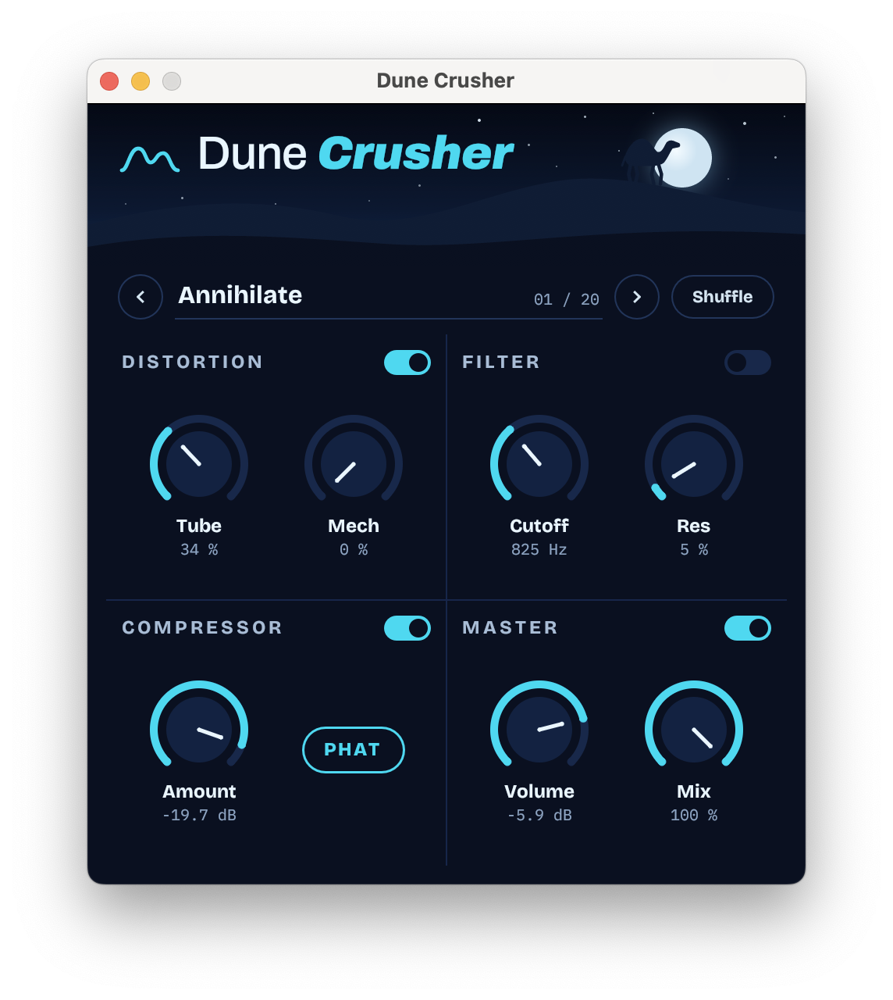

# Dune Crusher

A reimplementation of Camel Audio's CamelCrusher (discontinued) as a CLAP plugin (VST3
optional) in Rust.
See [docs/signal-chain.md](docs/signal-chain.md) for how the DSP works, block by block.

<p align="center">
  
</p>

- `dsp/`: the signal chain, with no dependencies. Includes `render`, an offline renderer for
  raw f32 files.
- `dsp/examples/play.rs`: plays an audio file (wav, flac, ogg, mp3) through the DSP to the
  default output device, with live knob changes typed into the terminal.
- `plugin/`: the nih-plug wrapper. It includes a custom egui editor. By default it builds
  CLAP only and links no GPL code. The `vst3` feature adds VST3 and makes the binary GPLv3.

```sh
cargo xtask bundle dune_crusher --release                   # -> target/bundled/dune_crusher.clap
cargo xtask bundle dune_crusher --release --features vst3    # + dune_crusher.vst3 (GPLv3)
cargo test -p dune-crusher-dsp
cargo lint                                                    # clippy, all targets, warnings are errors
pre-commit install                                            # run fmt + clippy before each commit

# listen: type `mech 0.8`, `cutoff 0.3`, `preset Destroyer`, `presets`, `show`, `q` while it plays
cargo run --release -p dune-crusher-dsp --example play -- song.wav --preset "British Crunch" --loop
```

## Credits

Dune Crusher recreates the sound of
[CamelCrusher](https://www.kvraudio.com/product/camelcrusher-by-camel-audio), the free
distortion, filter and compressor by Camel Audio. All credit for the original design, sound and
factory presets goes to Camel Audio. This project is not affiliated with or endorsed by Camel
Audio or Apple, and contains none of the original plugin's code or artwork. The CamelCrusher
name belongs to its owner.

Fonts are under the SIL Open Font License (see `plugin/assets/fonts/`).

## License

MIT, see [LICENSE](LICENSE). Builds with the `vst3` feature link GPLv3 code (`vst3-sys`), so
those binaries are GPLv3.
