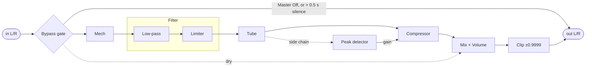

# Signal chain

How audio moves through the plugin, block by block. Every formula here is what the code in
`dsp/src` computes. Knob values are normalized to 0..1, `x` is an input sample (float, nominally
−1..1) and `y` the output.

Mech, Filter, Tube and Compressor each have an On switch (DistOn covers both Mech and Tube).
A module that is off is skipped entirely. Mech and Tube are also skipped when their knob is 0.
The filter sits between the two distortions.

## Timing

- **Blocks and chunks.** Module switches are sampled once per host block. Audio is then
  processed in chunks of up to 64 samples, and the knobs are read once per chunk.
- **Parameter ramps.** Every parameter, switches included, moves linearly to a new value over
  10 ms. The ramp advances each time the parameter is read, by the number of samples about to be
  processed. Master On and Phat also act immediately.
- **Startup.** Mix and Volume start at 0 and ramp up during the first chunk, so playback fades
  in. After a sample-rate change, the filter's state starts at −1, which gives a short sweep up
  from 80 Hz on its first chunk.

## Bypass gate

With Master Off, the input is copied to the output.

With Master On, each host block checks only the first and last sample of each channel. If all
four are below 3·10⁻⁵, a silence counter grows by the block length; otherwise it resets. Once
the counter passes 0.5 s, processing stops and the input passes through until a louder block
arrives. Filter and compressor state are frozen meanwhile.

## Mech

A gain stage followed by a hard corner at 0.75 and a straight line that reaches exactly 1.0 at
full-scale input. It has no memory and no oversampling, so the corner's harmonics alias.

$$
g = 1 + 10M, \qquad s = g x
$$

$$
y = \begin{cases}
s & |s| \le 0.75 \\
\mathrm{sgn}(s)\left(0.75 + \dfrac{0.25}{g - 0.75}\,(|s| - 0.75)\right) & \text{otherwise}
\end{cases}
$$

Signals above 0 dBFS keep rising past 1.0 here; only the final clip stops them.

## Low-pass filter

A 12 dB/octave RBJ-cookbook low-pass, one per channel. It runs in direct form I with
single-precision state; coefficients are computed in double precision.

$$
H(z) = \frac{b_0\,(1 + 2z^{-1} + z^{-2})}{1 + a_1 z^{-1} + a_2 z^{-2}}
$$

$$
b_0 = \frac{1 - \cos\omega_0}{2(1 + \alpha)}, \quad
a_1 = \frac{-2\cos\omega_0}{1 + \alpha}, \quad
a_2 = \frac{1 - \alpha}{1 + \alpha}, \quad
\alpha = \frac{\sin\omega_0}{2Q}
$$

$$
\omega_0 = 2\pi \frac{f_c}{f_s}, \qquad Q = 1 + 6R, \qquad
f_c = 80 + 15920 \cdot \mathrm{clamp}\!\left(\frac{-\log_{10}(1 - C)}{4},\, 0,\, 1\right) \text{ Hz}
$$

- Cutoff knob: 0 → 80 Hz, 0.5 → 1.28 kHz, 0.9 → 4.06 kHz, 1 → 16 kHz.
- Resonance gives Q from 1 to 7. At the cutoff that is a peak of about +1.3 dB at R = 0, +12 dB
  at R = 0.5 and +17 dB at R = 1.
- A cutoff change ramps linearly across the chunk; new coefficients take effect every
  16 samples.
- The cutoff goes through a MIDI-note conversion and is capped just below Nyquist.
- After each chunk the state is reset if it holds a denormal or exceeds ±1000.

### Limiter

Always active with the filter. A stereo-linked peak follower tracks
$\max(|L|, |R|)$, rising at most full-scale per 7.5 ms and falling full-scale per 50 ms. When
it exceeds 1, the gain drops to $1/e$ at once, then climbs back to 1 linearly over 7.5 s. In
practice it only acts when resonance pushes the output above 0 dBFS.

## Tube

A gain stage, linear up to 0.6, then a parabolic knee whose slope reaches zero at full scale.

$$
g = 1 + 4T, \qquad s = g x, \qquad u = \frac{|s| - 0.6}{g - 0.6}
$$

$$
y = \begin{cases}
s & |s| \le 0.6 \\
\mathrm{sgn}(s)\left(0.6 + 0.4\left(1 - (1 - u)^2\right)\right) & \text{otherwise}
\end{cases}
$$

Input above 0 dBFS makes $u > 1$, so the curve turns back down and folds over.

## Compressor

A stereo-linked feed-forward compressor. It has no threshold knob. Amount is a make-up gain of
0 to +40 dB that drives the signal into a fixed soft knee, which starts at 0.31 and lands on 1.0.

$$
m = \frac{1}{1 - 0.99A}, \qquad \ell = m\,d, \qquad k = \frac{\ell - 0.31}{m - 0.31}
$$

$$
g_{\text{target}} = \frac{0.31 + 0.69\left(1 - (1 - k)^2\right)}{\ell}
\quad \text{if } \ell > 0.31, \qquad y = g \cdot m x
$$

- Gain drops to the target instantly, then recovers linearly over 0.25 ms.
- The detector `d` is the stereo peak $\max(|L|, |R|)$:
  - **Phat on:** used raw for every sample. With the 0.25 ms recovery the compressor acts as a
    waveshaper, which is where Phat's density, and its occasional crackle, come from.
  - **Phat off:** a linear follower (full-scale in 30 ms up, 80 ms down), which behaves like a
    conventional compressor.
- The make-up gain is read once per chunk, so it lags the knob by one chunk.
- On the very first chunk after instantiation, gain recovery is immediate.

## Mix, Volume and Clip

$$
y = \mathrm{clip}_{\pm 0.9999}\left( V^{2.737} \cdot \left( (1 - X)\, x_{\text{dry}} + X\, y_{\text{wet}} \right) \right)
$$

The dry signal is the input before Mech. Mix and Volume ramp linearly across each chunk.

## Parameters

| # | Parameter      | Display                                  |
|---|----------------|------------------------------------------|
| 0 | DistOn         | on above 0.5                             |
| 1 | DistMech       | %                                        |
| 2 | DistTube       | %                                        |
| 3 | MmFilterOn     | on above 0.5                             |
| 4 | MmFilterCutoff | $f_c$ in Hz, formula above               |
| 5 | MmFilterRes    | %                                        |
| 6 | CompressOn     | on above 0.5                             |
| 7 | CompressAmount | $20\log_{10}(1 - 0.99A)$ dB, 0 to −40    |
| 8 | CompressMode   | Phat on at 0.5 and above                 |
| 9 | MasterOn       | bypass below 0.5                         |
| 10| MasterMix      | %                                        |
| 11| MasterVolume   | $20\log_{10}(V^{2.737})$ dB; 0.5 → −16.5 dB |

CompressAmount is scaled to 0..0.99 internally, so the make-up gain never becomes infinite.
